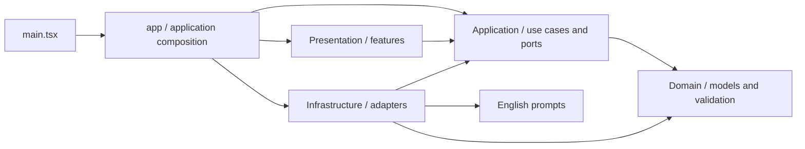

# Vibe architecture

Status: stages 3–5. Stages 0–2 were accepted; the user explicitly authorized the next three stages together. Generation, vocabulary lookup and grammar are implemented. Completion/adaptive repetition, history UI and import/export remain stages 6–7.

## Stack and tooling decisions

A modular frontend monolith: React 19 for a component-based UI, TypeScript 6 with strict mode, and Vite 8 for static builds. React/Vite are retained from stage 0. The application uses plain CSS and standard fetch; the current workflow does not need a separate router, UI library, backend, event bus, or plugin framework.

TypeScript is pinned to `~6.0.0`: the selected `typescript-eslint` supports versions below 6.1, and dependency-cruiser supports versions below 7. This is a tested, compatible replacement for stage 0's TypeScript 7. ESLint 10 and React Hooks rules check code; Prettier 3 and EditorConfig define formatting. Vitest 5 runs unit tests, and Playwright checks production UI in Chromium. Dependencies are fixed in package-lock.json; CI uses Node.js 22.

## Layers and import directions



Arrows represent source dependencies. At runtime, Application calls injected adapters through ports; use cases therefore do not import the adapter classes.

| Area                       | Responsibility                                               | Allowed dependencies                                                        |
| -------------------------- | ------------------------------------------------------------ | --------------------------------------------------------------------------- |
| `src/main.tsx`, `src/app/` | React startup, dependency composition, and composition root  | Features, Application; Infrastructure only from `app/create-services.ts`    |
| `src/features/`            | Components, UI state, accessibility, and future gestures     | Application, Domain, React; direct imports of other features are prohibited |
| `src/application/`         | Use cases and interfaces for external actions                | Application, Domain; no browser IO or SDKs                                  |
| `src/domain/`              | Pure preferences, learning models, and structural validation | Domain only; no React, SDKs, Node.js, or browser APIs                       |
| `src/infrastructure/`      | HTTP and local adapters                                      | Application, Domain, Infrastructure, prompts, and necessary SDKs            |
| `src/prompts/`             | Separate English model instructions                          | No business-logic imports                                                   |

Concrete adapters are created in `src/app/create-services.ts`. `SettingsPage` receives `SettingsActions` through props. Use cases receive `AIProvider` and `StorageRepository`; plain mock objects implementing these interfaces are sufficient for tests.

## Current structure

```text
src/
  main.tsx
  app/
    App.tsx
    create-services.ts
  features/
    settings/SettingsPage.tsx
    reader/{GenerationPanel,Reader}.tsx
    reader/use-reader-gestures.ts
    vocabulary/{VocabularyCard,VocabularyList}.tsx
    grammar/GrammarCard.tsx
    history/README.md
  application/
    ports/
      ai-provider.ts
      learning-ai-provider.ts
      runtime.ts
      storage-repository.ts
      learning-repository.ts
    use-cases/
      check-connection.ts
      settings.ts
      generate-text.ts
      lookup-word.ts
      explain-grammar.ts
    errors.ts
  domain/
    reading/{models,tokens}.ts
    vocabulary/{models,lookups,word-card}.ts
    learning/{data,records,validation}.ts
    grammar/models.ts
    settings/{app-settings,model-preferences}.ts
  infrastructure/
    browser-runtime.ts
    ai/{openai-connection,prompt-registry,structured-outputs}.ts
    storage/
      local-settings.ts
      indexeddb-learning.ts
      learning-database.ts
      schema.ts
  prompts/{connection-check,text-generation,word-translation,grammar-explanation}.md
  style.css
tests/
  connection.test.ts
  settings.test.ts
  architecture.test.ts
  browser-check.mjs
  live-cors-check.mjs
  learning-validation.test.ts
  learning-storage.test.ts
  learning-migrations.test.ts
  storage-browser-check.mjs
  generation.test.ts
  learning-actions.test.ts
  structured-ai.test.ts
  learning-browser-check.mjs
  fixtures/{learning,provider}.ts
```

Reader renders tokenized German text and recognizes gestures; Vocabulary renders the contextual card and personal list; Grammar renders explanations. These features receive typed actions/callbacks and have no direct feature-to-feature imports. App composes their state and props. History remains a documented boundary. Domain contains the seven primary learning entities plus word-lookup and translation records, exact token offsets, normalization and mark/undo rules. It has no browser APIs.

## Ports and the Settings workflow

`AIProvider.check(ConnectionRequest): Promise<ConnectionResult>` is the current connection-check contract. It contains no OpenAI SDK or HTTP Response types. `ConnectionError` carries a safe UI message. `LearningAIProvider` extends the connection contract with typed generate/translate/explain operations and prompt versions. One `OpenAIConnectionProvider` instance implements both contracts and is injected into all use cases. Its historical class name is retained for compatibility; every operation shares its transport and busy limit.

`StorageRepository.loadSettings()` and `saveSettings()` describe the current small local connection settings. `LocalSettingsRepository` implements it using the original localStorage names. The separate `LearningRepository` port describes typed entity reads, session-specific event/exposure reads, and atomic `commit(LearningWrite)`, and explicit resolve/undo operations for durable word lookups. Cache and vocabulary queries are typed by their domain context. It exposes no IndexedDB types, arbitrary store names, deletion API, or callback that could introduce network waits inside transactions. `IndexedDbLearningRepository` implements this port and is constructed only in `app/create-services.ts`.

`createSettingsActions` connects loading, saving, key deletion, and `checkConnection`. A storage load failure returns a safe snapshot: an empty key, the default model, and a flag indicating that persistence is unavailable. Write errors propagate to the calling UI, which displays a fixed message. AI checks do not write settings; AI errors do not change local data.

The key is not part of Domain: neither `ModelPreferences` nor `AppSettings` contains it. The key is passed through current Application connection contracts and stored separately by the adapter. Existing localStorage names, `vibe.openai-api-key` and `vibe.openai-model`, are preserved. Generation saves level/duration preferences in AppSettings and preserves stored UI preferences. The connection screen continues to use its existing settings adapter; learning actions load the saved connection values on explicit user actions.

The OpenAI adapter preserves stage 0 behavior: a fixed HTTPS endpoint, CORS, no cookies/redirects, timeout, cancellation, deduplication, and safe errors. A future backend proxy requires only another `AIProvider` adapter and a composition-root change. UI and the use case remain unchanged.

## IndexedDB decisions

Use the native IndexedDB API, without a production database dependency. Database `vibe.learning`, schema version 2, has nine stores and an explicit ordered migration registry. Migration 1 created the initial seven stores; migration 2 adds wordLookups/wordTranslations and their indexes, preserving existing records. Connection settings require no migration. See [data-model.md](data-model.md) for records, indexes, and invariants.

The adapter takes a snapshot of incoming records, validates shapes without browser dependencies, and writes a batch in a single read/write transaction. It checks references against the staged and existing records in that same transaction, reading only referenced IDs. Transactions covering the learning stores serialize competing updates. Promise success means the transaction's `complete` event, as defined by the [IndexedDB specification](https://www.w3.org/TR/IndexedDB/), rather than the success of an individual request. Validation, uniqueness, capacity, or request failures abort the entire batch. Fixed application errors do not expose records or browser diagnostics.

Documents, interactions, exposures, and explanations are immutable after insertion; an identical repeated write is accepted. Vocabulary state, unfinished-session position/state, AppSettings and lookup lifecycle states may be updated. Completed sessions cannot be changed. This supplies transaction primitives for stage 6; it does not compute word statuses or session-completion results. Included vocabulary IDs must be a subset of target IDs, but meaning-aware detection of actual occurrences belongs to stage 6.

The database opens lazily and deduplicates concurrent opens. Migration failure never deletes or recreates existing data. A newer existing version is refused; `versionchange` closes the old connection. Blocked opens produce a retryable error and abort any later deferred upgrade from that rejected request. Every future schema change must add an ordered migration and rollback tests; no hypothetical next migration is shipped.

`fake-indexeddb` is a development-only dependency for repository and migration tests. Native Chromium tests separately verify reload persistence, rollback, concurrent tab writes, and failed migration recovery. These fixtures are served only by the test server and are absent from the production build.

## Learning workflows and AI contracts

GenerateText supplies CEFR, duration, a word-count target and five recent titles to the AI provider. The model returns an ordered sentence array; the application constructs the document and assigns sentence IDs from its UUID and sentence order. It saves document, initial InProgress session, and preferences in one transaction. The latest document/session are restored by local reads on mount. No AI request runs on render or restore. Full session/position recovery and adaptive vocabulary selection remain stage 6, so current review lists are empty.

LookupWord persists a Pending WordLookup before requesting AI. The full sentence and exact UTF-16 token offsets provide context. Up to 100 recent vocabulary candidates let the model explicitly verify a matching sense; supplied IDs must also match normalized lemma, part of speech and article. An uncertain or new sense receives a fresh identity. This is a conservative policy; spelling alone never causes a merge. Inflections, separable verbs, and multiword expressions are represented by the lemma plus contextual card/expression and the original surface-form interaction.

Resolution runs entirely within a write transaction: it rereads the lookup, cache and current vocabulary, records the previous mark state, increments Unknown state, stores the immutable translation, and appends WordInteraction. Repeated resolution of the same intent is idempotent. A concurrent cache winner is reused; counters are read and changed atomically rather than overwritten from stale AI snapshots. Undo atomically appends the corresponding UndoMarkUnknown, cancels the intent, and restores the remaining effective mark state for that session. Pending failures remain retryable across refresh and may be cancelled without creating vocabulary. AI cache deletion never rewrites events.

ExplainGrammar receives the exact sentence and text CEFR level. Its cache key includes text, sentence, level, model and prompt version. Runtime checks require explanation fragments to occur in the selected sentence. Grammar writes only GrammarExplanation; it never calls vocabulary operations. Concurrent equivalent cache writes reuse the committed winner.

The Prompt Registry reads the three separate English Markdown files and their version metadata. The adapter uses strict Responses API `text.format` JSON Schema, based on the [official OpenAI documentation](https://developers.openai.com/api/docs/guides/structured-outputs?api-mode=responses), and validates returned shapes, completion, refusal and contextual fragments. HTTP diagnostics and raw bodies never reach UI. Token totals are returned for display when available. Connection timeout is 20 seconds, learning timeout 60 seconds; each operation supports abort. One provider permits one active request. Use cases and UI also prevent concurrent actions; retries require explicit user action.

Reader renders original whitespace and punctuation around Unicode word tokens. Pointer recognition uses a 500 ms hold and an 8 px movement threshold. Scroll, pointer cancellation, secondary touches and focus loss cancel recognition. The resulting synthetic click is suppressed until the next intentional pointer action; keyboard activation remains available. Sentence-analysis buttons provide an accessible alternative. Cards appear over the current viewport with the source sentence and render text through React, without HTML injection. Real Android Chrome gesture verification is still required.

## Automated boundary enforcement

`npm run check:architecture` analyzes the entire `src` graph with dependency-cruiser: cycles, unresolved imports, reversed layer dependencies, direct dependencies between features, vendor SDKs in UI, and adapters created outside the composition root. `tsPreCompilationDeps` includes type-only imports in the analysis.

`npm run lint` prohibits direct access to fetch, XMLHttpRequest, WebSocket, IndexedDB, localStorage, and sessionStorage from Presentation/Application/Domain, including access through window/globalThis/self. Domain is also compiled separately with `tsconfig.domain.json`, without DOM libraries or browser/Node.js ambient types.

Architecture unit tests build independent temporary graphs and verify that allowed dependencies pass while prohibited imports and cycles fail. They exercise the actual configurations rather than copied rules. These tests do not modify project source files.

Static analysis protects against ordinary import violations and direct browser API usage. Architectural review remains necessary for bypasses through aliases or hidden third-party-library calls. Do not add source comments; important decisions are documented here.

## Checks and deployment

`npm run check`: both typechecks → lint with no warnings → formatting check → dependency graph → unit tests → production build. Then `npm run test:browser` checks the application with mock API responses on production preview `/vibe/` using a mobile viewport, followed by native IndexedDB tests on a separate Vite test server and production learning/gesture tests using mocked API responses and native Chromium touch events.

GitHub Actions repeats these checks, publishes only `dist`, and deploys exclusively from `main` after the build job succeeds. GitHub Pages Source must remain **GitHub Actions**. Vite base URL is `/vibe/`; the current UI does not use nested routes.

`npm run check:cors` is a separate explicit diagnostic that expects a real HTTP 401 with a deliberately invalid key. It does not run in CI. Automated tests do not use real user keys, log them, or include them in builds.
