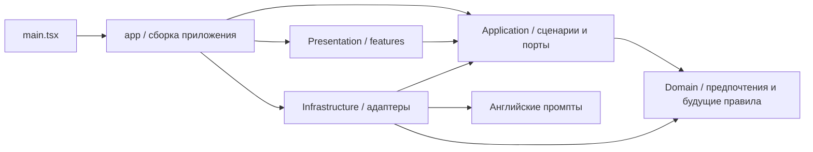

# Архитектура Vibe

Статус: каркас этапа 1. Этап 0 принят пользователем сообщением «Работает. Сделай следующий этап». Учебные модели, IndexedDB и функции следующих этапов пока не реализованы.

## Стек и выбор инструментов

Модульный frontend-монолит: React 19 для компонентного UI, TypeScript 6 со strict mode, Vite 8 для статической сборки. React/Vite сохранены из этапа 0. Используется обычный CSS и стандартный fetch; отдельный роутер, UI-библиотека, backend, event bus и plugin framework не нужны текущему сценарию.

TypeScript закреплён в диапазоне `~6.0.0`: используемый `typescript-eslint` поддерживает версии ниже 6.1, а dependency-cruiser — ниже 7. Это совместимая проверенная замена TypeScript 7 этапа 0. ESLint 10 и React Hooks проверяют код; Prettier 3 и EditorConfig задают форматирование. Vitest 5 выполняет unit-тесты, Playwright проверяет production UI в Chromium. Зависимости фиксируются package-lock.json; CI использует Node.js 22.

## Слои и направления импортов



Стрелки показывают зависимости исходников. Во время выполнения Application вызывает внедрённые адаптеры через порты; поэтому сценарий не импортирует их классы.

| Область                    | Ответственность                                       | Допустимые зависимости                                                   |
| -------------------------- | ----------------------------------------------------- | ------------------------------------------------------------------------ |
| `src/main.tsx`, `src/app/` | Запуск React, сборка зависимостей и composition root  | Features, Application; Infrastructure только из `app/create-services.ts` |
| `src/features/`            | Компоненты, состояние UI, доступность и будущие жесты | Application, Domain, React; прямые импорты других features запрещены     |
| `src/application/`         | Сценарии и интерфейсы внешних действий                | Application, Domain; нет browser IO или SDK                              |
| `src/domain/`              | Чистые предпочтения и будущие учебные правила         | Только Domain; нет React, SDK, Node.js или browser API                   |
| `src/infrastructure/`      | HTTP и локальные адаптеры                             | Application, Domain, Infrastructure, промпты и необходимые SDK           |
| `src/prompts/`             | Отдельные английские инструкции модели                | Не импортируют бизнес-логику                                             |

Точка создания конкретных адаптеров — `src/app/create-services.ts`. `SettingsPage` получает `SettingsActions` через props. Сценарии получают `AIProvider` и `StorageRepository`; для тестов подходят обычные mock-объекты этих интерфейсов.

## Текущая структура

```text
src/
  main.tsx
  app/
    App.tsx
    create-services.ts
  features/
    settings/SettingsPage.tsx
    reader/README.md
    vocabulary/README.md
    grammar/README.md
    history/README.md
  application/
    ports/
      ai-provider.ts
      storage-repository.ts
    use-cases/
      check-connection.ts
      settings.ts
  domain/settings/model-preferences.ts
  infrastructure/
    ai/openai-connection.ts
    storage/local-settings.ts
  prompts/connection-check.md
  style.css
tests/
  connection.test.ts
  settings.test.ts
  architecture.test.ts
  browser-check.mjs
  live-cors-check.mjs
```

Reader, Vocabulary, Grammar и History пока представлены каталогами с описанием границ. Они не добавляют неработающие кнопки или учебные сценарии в UI. Domain сейчас содержит только предпочтение модели, используемое текущими настройками. Учебные сущности и инварианты будут добавляться в соответствующих этапах.

## Порты и сценарий Settings

`AIProvider.check(ConnectionRequest): Promise<ConnectionResult>` — текущий контракт проверки подключения. В нём нет типов OpenAI SDK или HTTP Response. `ConnectionError` содержит безопасное сообщение для UI. Контракты генерации, перевода и грамматики будут добавлены по конкретной потребности в этапах 3–5, без универсального метода с невалидируемыми данными.

`StorageRepository.loadSettings()` и `saveSettings()` — текущий контракт небольших локальных настроек. Это не универсальный CRUD для будущих учебных сущностей. Сейчас он реализован `LocalSettingsRepository`; репозитории документов, сеансов и словаря появятся в этапе 2 вместе со схемой и миграциями.

`createSettingsActions` связывает загрузку, сохранение, удаление ключа и `checkConnection`. Ошибка загрузки хранилища возвращает безопасный snapshot: пустой ключ, стандартную модель и флаг недоступного сохранения. Ошибка записи передаётся вызывающему UI, который показывает фиксированное сообщение. Проверка AI не записывает настройки; ошибка AI не меняет локальные данные.

Ключ не относится к Domain: `ModelPreferences` содержит только `model`. Ключ передаётся через текущие Application-контракты подключения и отдельно сохраняется адаптером. Существующие localStorage-имена `vibe.openai-api-key` и `vibe.openai-model` сохранены. Формат данных не изменён, IndexedDB не создаётся, миграция на этом этапе не нужна.

OpenAI-адаптер сохраняет поведение этапа 0: фиксированный HTTPS endpoint, CORS, отсутствие cookies/redirects, таймаут, отмена, исключение дубликатов и безопасные ошибки. Чтобы заменить его на backend proxy в будущем, достаточно другого адаптера `AIProvider` и изменения composition root. UI и сценарий не меняются.

## Автоматическое соблюдение границ

`npm run check:architecture` проверяет весь граф `src` с dependency-cruiser: циклы, неразрешённые импорты, обратные зависимости слоёв, прямые зависимости features друг от друга, vendor SDK в UI и создание адаптеров вне composition root. `tsPreCompilationDeps` включает type-only импорты в анализ.

`npm run lint` запрещает прямой доступ к fetch, XMLHttpRequest, WebSocket, IndexedDB, localStorage и sessionStorage из Presentation/Application/Domain, включая обращения через window/globalThis/self. Domain дополнительно компилируется отдельным `tsconfig.domain.json` без DOM-библиотек и ambient-типов браузера/Node.js.

Unit-тесты архитектуры строят независимые временные графы и проверяют, что допустимые зависимости проходят, а запрещённые импорты и циклы отклоняются. Проверяются реальные конфигурации, а не отдельные скопированные правила. Исходники проекта во время этих тестов не изменяются.

Статический анализ — защита от обычных нарушений импортов и прямых browser API. Архитектурный review нужен для обходов через aliases или скрытые вызовы сторонних библиотек. Комментарии в исходном коде не добавляются; существенные решения описываются здесь.

## Проверки и публикация

`npm run check`: оба typecheck → lint без предупреждений → проверка форматирования → граф зависимостей → unit-тесты → production build. Затем `npm run test:browser` проверяет приложение с mock API на production preview `/vibe/` в мобильном viewport.

GitHub Actions повторяет эти проверки, публикует только `dist` и выполняет deployment исключительно из `main` после успешного build job. Source GitHub Pages должен оставаться **GitHub Actions**. Base URL Vite — `/vibe/`, текущий UI не использует вложенные маршруты.

`npm run check:cors` — отдельная явная диагностика реального HTTP 401 с заведомо неверным ключом. Она не выполняется в CI. Реальные пользовательские ключи не используются в автоматических тестах, не выводятся в логи и не входят в сборку.
